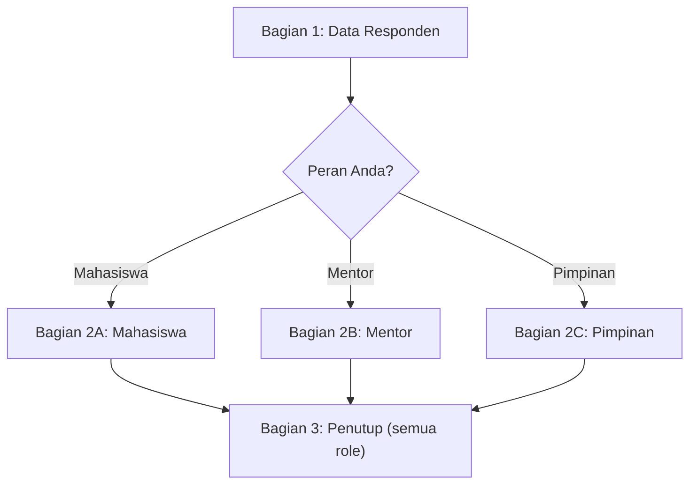

# Rancangan Kuesioner Kepuasan Pengguna LMS (Google Form)

## 1. Analisis Fitur per Role (berdasarkan kode project)

| Role | Role di sistem | Fitur utama yang dipakai |
|---|---|---|
| **Mahasiswa** | `mahasiswa` | Registrasi kelas, Kelas & Kelas Harian, Materi, Tugas (reguler, harian, pekanan), Absensi, Laporan Ibadah, SKL (Buku, Portofolio, Project Semester, Sertifikat), Profil/NIM |
| **Mentor** | `dosen` | Jadwal mengajar, Kelas & Kelas Harian, Upload Materi, Membuat Tugas & memberi nilai (termasuk Tugas Pekanan), Verifikasi SKL, Rekap absensi |
| **Pimpinan** | `admin` / user dengan izin `sidebar.grafik.*` & Monitoring | Dashboard, Grafik Absensi, Statistik Kelas Harian, Grafik SKL (+ cetak), Grafik Laporan Ibadah, Monitoring Asdos/Mentor, Monitoring Mahasiswa, Export Excel |

Jadi setiap role menilai hal yang **berbeda**: mahasiswa menilai *kemudahan belajar*, mentor menilai *efisiensi mengajar & administrasi*, pimpinan menilai *kualitas informasi untuk pengambilan keputusan*.

---

## 2. Soal Rating: Bagus atau Tidak?

**Bagus, dan sebaiknya memang dipakai**, karena rating bisa dihitung (rata-rata, persentase, grafik), sedangkan jawaban teks sulit direkap. Tapi ada aturannya:

| Rekomendasi | Alasan |
|---|---|
| Pakai **Skala Linier 1–5** (Likert) | Standar penelitian, mudah dipahami, mudah dihitung |
| Beri label: 1 = *Sangat Tidak Setuju*, 5 = *Sangat Setuju* | Tanpa label, responden menafsirkan angka berbeda-beda |
| Arah skala **konsisten** di semua pertanyaan | Mencegah responden salah isi |
| Pertanyaan berupa **pernyataan positif** ("Menu mudah ditemukan") | Lebih mudah dijawab dengan Setuju/Tidak Setuju |
| **Satu pernyataan = satu hal** | Hindari "Materi lengkap *dan* mudah diunduh" (double-barreled) |
| Tetap tambahkan **2–3 pertanyaan terbuka** | Rating memberi tahu *seberapa puas*, teks memberi tahu *kenapa* |
| Hindari tipe *Rating Bintang* untuk butir penelitian | Bintang tidak punya label makna; lebih cocok untuk 1 pertanyaan kepuasan umum |

> [!TIP]
> Tambahkan 1 pertanyaan **NPS (Net Promoter Score)** skala 0–10: *"Seberapa besar kemungkinan Anda merekomendasikan LMS ini kepada orang lain?"* — skor ini bagus sebagai indikator tunggal kepuasan keseluruhan.

### Kerangka standar (opsional, cocok untuk skripsi/penelitian)

| Instrumen | Isi | Cocok untuk |
|---|---|---|
| **SUS** (System Usability Scale) | 10 butir baku, hasil skor 0–100 (≥ 68 = di atas rata-rata) | Mengukur *usability* secara umum, bisa dibandingkan antar role |
| **EUCS** (End User Computing Satisfaction) | 5 dimensi: *Content, Accuracy, Format, Ease of Use, Timeliness* | Mengukur *kepuasan* pengguna sistem informasi; sering dipakai di skripsi Indonesia |

Pertanyaan di bawah sudah saya beri **tag dimensi EUCS** (C/A/F/E/T) supaya bisa dianalisis per dimensi.

---

## 3. Struktur Google Form

> [!NOTE]
> Di Google Form, gunakan fitur **"Buka bagian berdasarkan jawaban"** pada pertanyaan *Peran*, lalu di akhir setiap bagian role, atur **"Setelah bagian ini → Bagian Penutup"**.

---

## Bagian 1 — Data Responden (semua role)

| No | Pertanyaan | Tipe |
|---|---|---|
| 1 | Peran Anda di LMS | Pilihan ganda: Mahasiswa / Mentor / Pimpinan *(branching)* |
| 2 | Program Studi | Dropdown |
| 3 | Sudah berapa lama menggunakan LMS? | < 1 bulan / 1–3 bulan / 3–6 bulan / > 6 bulan |
| 4 | Seberapa sering mengakses LMS? | Setiap hari / Beberapa kali seminggu / Seminggu sekali / Jarang |
| 5 | Perangkat yang paling sering digunakan | HP / Laptop-PC / Tablet |

> [!IMPORTANT]
> Sebaiknya form dibuat **anonim** (matikan "Kumpulkan email"), terutama untuk mahasiswa dan mentor, agar jawaban jujur.

---

## Bagian 2A — Mahasiswa (Skala 1–5)

| No | Pernyataan | Fitur | EUCS |
|---|---|---|---|
| M1 | Proses login ke LMS mudah dan lancar | Login | E |
| M2 | Tampilan LMS menarik dan rapi | Umum | F |
| M3 | Menu dan fitur mudah ditemukan | Umum | E |
| M4 | LMS nyaman digunakan melalui HP | Umum | F |
| M5 | Proses registrasi/pemilihan kelas mudah dilakukan | Registrasi Kelas | E |
| M6 | Informasi jadwal kelas jelas | Kelas/Jadwal | C |
| M7 | Materi perkuliahan mudah diakses | Materi | E |
| M8 | Materi tersedia tepat waktu sesuai jadwal | Materi | T |
| M9 | Instruksi dan batas waktu tugas jelas | Tugas | C |
| M10 | Proses pengumpulan tugas (reguler, harian, pekanan) mudah | Tugas | E |
| M11 | Nilai dan umpan balik tugas dari mentor dapat saya lihat dengan jelas | Tugas | C |
| M12 | Absensi mudah dilakukan | Absensi | E |
| M13 | Rekap kehadiran saya ditampilkan dengan akurat | Absensi | A |
| M14 | Pengisian Laporan Ibadah mudah dilakukan | Laporan Ibadah | E |
| M15 | Laporan Ibadah membantu saya mengevaluasi konsistensi ibadah | Laporan Ibadah | C |
| M16 | Upload berkas SKL (buku, portofolio, project, sertifikat) mudah | SKL | E |
| M17 | Progres/status SKL saya mudah dipantau | SKL | C |
| M18 | Halaman LMS terbuka dengan cepat | Performa | T |
| M19 | LMS jarang mengalami error saat digunakan | Performa | A |
| M20 | LMS membantu proses belajar saya | Manfaat | C |

**Pertanyaan terbuka:**
- Fitur apa yang paling bermanfaat bagi Anda?
- Kendala apa yang paling sering Anda alami?

---

## Bagian 2B — Mentor (Skala 1–5)

| No | Pernyataan | Fitur | EUCS |
|---|---|---|---|
| D1 | Tampilan LMS mudah dipahami | Umum | F |
| D2 | Informasi jadwal mengajar jelas | Jadwal | C |
| D3 | Mengelola kelas dan kelas harian mudah dilakukan | Kelas | E |
| D4 | Upload materi (file/video) mudah dilakukan | Materi | E |
| D5 | Membuat tugas (reguler, harian, pekanan) mudah dilakukan | Tugas | E |
| D6 | Melihat pengumpulan tugas mahasiswa mudah | Tugas | E |
| D7 | Proses pemberian nilai efisien | Penilaian | E |
| D8 | Rekap absensi mahasiswa akurat | Absensi | A |
| D9 | Proses verifikasi SKL mahasiswa mudah | SKL | E |
| D10 | LMS membantu saya memantau perkembangan mahasiswa (akademik, ibadah, SKL) | Monitoring | C |
| D11 | Data yang ditampilkan selalu terbaru (*up to date*) | Data | T |
| D12 | LMS menghemat waktu administrasi dibanding cara manual | Manfaat | T |
| D13 | Halaman LMS terbuka dengan cepat | Performa | T |
| D14 | LMS jarang mengalami error saat digunakan | Performa | A |

**Pertanyaan terbuka:**
- Pekerjaan apa yang masih terasa repot di LMS?
- Fitur apa yang perlu ditambahkan untuk membantu mengajar?

---

## Bagian 2C — Pimpinan (Skala 1–5)

| No | Pernyataan | Fitur | EUCS |
|---|---|---|---|
| P1 | Dashboard memberikan gambaran ringkas kondisi pembelajaran | Dashboard | C |
| P2 | Grafik absensi dan kelas harian mudah dipahami | Grafik | F |
| P3 | Grafik SKL memberikan informasi yang saya butuhkan | Grafik SKL | C |
| P4 | Grafik Laporan Ibadah memberikan informasi yang saya butuhkan | Grafik Ibadah | C |
| P5 | Fitur Monitoring Mentor/Asdos membantu mengevaluasi kinerja pengajar | Monitoring | C |
| P6 | Fitur Monitoring Mahasiswa membantu mengidentifikasi mahasiswa yang perlu perhatian | Monitoring | C |
| P7 | Data yang ditampilkan akurat | Data | A |
| P8 | Data yang ditampilkan selalu terbaru (*real-time / up to date*) | Data | T |
| P9 | Filter data (periode, kelas, angkatan) sudah memadai | Filter | E |
| P10 | Laporan dapat dicetak/diekspor sesuai kebutuhan | Laporan | F |
| P11 | Pengaturan hak akses pengguna sudah aman dan sesuai | Keamanan | A |
| P12 | LMS membantu saya dalam pengambilan keputusan | Manfaat | C |
| P13 | LMS sesuai dengan tujuan dan kebutuhan lembaga | Manfaat | C |

**Pertanyaan terbuka:**
- Laporan/informasi apa yang belum tersedia namun Anda butuhkan?
- Apa prioritas pengembangan LMS ke depan menurut Anda?

> [!WARNING]
> Jumlah responden pimpinan biasanya sangat sedikit (1–5 orang), sehingga tidak cukup untuk analisis statistik. Untuk role ini, hasil cukup disajikan **deskriptif**, atau dilengkapi **wawancara singkat**.

---

## Bagian 3 — Penutup (semua role)

| No | Pertanyaan | Tipe |
|---|---|---|
| Z1 | Secara keseluruhan, seberapa puas Anda dengan LMS ini? | Skala 1–5 (Sangat Tidak Puas → Sangat Puas) |
| Z2 | Seberapa besar kemungkinan Anda merekomendasikan LMS ini? | Skala 0–10 (NPS) |
| Z3 | Kritik dan saran untuk pengembangan LMS | Paragraf (opsional) |

---

## 4. Cara Mengolah Hasil

**Rata-rata per butir/dimensi (Likert 1–5):**

| Rata-rata | Kategori |
|---|---|
| 1,00 – 1,80 | Sangat Tidak Puas |
| 1,81 – 2,60 | Tidak Puas |
| 2,61 – 3,40 | Cukup |
| 3,41 – 4,20 | Puas |
| 4,21 – 5,00 | Sangat Puas |

**Persentase kepuasan:**

$$\text{Indeks} = \frac{\text{Total skor diperoleh}}{\text{Skor maksimal} \times \text{Jumlah responden}} \times 100\%$$

**NPS:** % Promoter (skor 9–10) − % Detractor (skor 0–6). Hasil > 0 berarti baik, > 50 sangat baik.

> [!TIP]
> Jika dipakai untuk skripsi/penelitian, lakukan **uji validitas & reliabilitas** (Pearson + Cronbach's Alpha ≥ 0,6) terhadap butir Likert sebelum data dianalisis.

---

## 5. Estimasi Waktu Pengisian

| Role | Jumlah butir | Estimasi |
|---|---|---|
| Mahasiswa | 5 + 20 + 2 + 3 = 30 | ± 7 menit |
| Mentor | 5 + 14 + 2 + 3 = 24 | ± 6 menit |
| Pimpinan | 5 + 13 + 2 + 3 = 23 | ± 6 menit |

Usahakan tetap **di bawah 10 menit** agar responden tidak asal mengisi.
