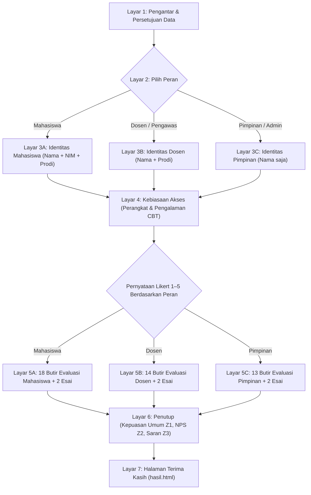

# Rancangan Kuesioner Kepuasan Pengguna PintarUji (CBT)

Instrumen kuesioner evaluasi kepuasan layanan pengguna untuk aplikasi **PintarUji (Computer-Based Test)** Politeknik IDN Jonggol, Kabupaten Bogor. Dirancang berdasarkan pemetaan menyeluruh terhadap fitur, alur kerja, dan basis data aktual pada kode aplikasi Laravel + Inertia React PintarUji.

---

## 1. Analisis Fitur per Role (Berdasarkan Kode Nyata PintarUji)

| Role Pengguna | Kode Sistem | Cakupan Fitur Utama yang Digunakan |
|---|---|---|
| **Mahasiswa** | `mahasiswa` | Cek Akun & Jadwal Publik (NIM), Login Mandiri (NIM/Email), Dashboard Ujian, Tanda Tangan Digital (Signature Pad), Informasi Jadwal & Ruangan Ujian, Tata Tertib & Konfirmasi Ujian, Input Token Ujian, Ruang Pengerjaan Ujian (Timer hitung mundur real-time, Autosave berkala, Palet navigasi nomor soal, Penanda Ragu-ragu, Zoom ukuran teks, Mode Layar Penuh/Fullscreen, Soal Bergambar & PG/Esai, Acak Soal & Opsi), Proteksi Anti-Cheat (Peringatan Tab Switching, Blokir Shortcut & Klik Kanan, Kunci Sesi otomatis pada pelanggaran ke-2), Ringkasan Selesai Ujian & Perolehan Skor Pilihan Ganda Instan, serta Unduh/Cetak Kartu Ujian. |
| **Dosen / Pengawas** | `dosen` | Dashboard Dosen, Kelola Bank Soal per Mata Kuliah (jenis: UTS, UAS, Kuis, Remedial), Input Butir Soal (Pilihan Ganda & Esai, Media Gambar, Bobot, Pembahasan), Import Butir Soal dari Template Excel, Export Bank Soal, Jadwal Mengajar & Jadwal Pengawasan Ujian, Kelola Presensi Peserta Ujian (Hadir, Tidak Hadir, Izin), Monitoring Ujian Realtime (Pemantauan status peserta, Buka kunci / Unlock sesi mahasiswa yang melanggar tab, Reset sesi ujian), Tinjau Detail Jawaban Mahasiswa, Cetak/Export Excel Dokumen Daftar Nilai Resmi. |
| **Pimpinan / Admin** | `admin` | Dashboard Admin (Statistik mahasiswa, dosen, matakuliah, ujian), Master Data Akademik (Tahun Angkatan, Program Studi + Kontak Layanan Admin/WhatsApp, Ruangan Ujian, Mata Kuliah), Manajemen Akun Pengguna (Aktivasi/Nonaktifkan akun massal, Reset kata sandi massal), Penjadwalan Ujian (Deteksi bentrok jadwal ruang/pengawas, Auto-generate jadwal ujian, Pengaturan Token Ujian tunggal/massal), Manajemen Peserta Ujian (Tambah/Hapus peserta batch, Penomoran kursi), Live Monitoring Ujian Kampus Realtime (Buka kunci & reset sesi massal), Cetak Dokumen Resmi Kampus (Berita Acara Pelaksanaan, Daftar Hadir Peserta, Daftar Nilai, Rekap Nilai Ujian multi-sheet Excel), dan Cetak Kartu Ujian Mahasiswa Massal. |

> [!NOTE]
> Peran dalam sistem PintarUji menilai dimensi yang berbeda namun saling melengkapi:
> - **Mahasiswa** menilai *kemudahan akses, kenyamanan ruang ujian, keandalan timer, autosave, dan rasa adil dari anti-cheat*.
> - **Dosen / Pengawas** menilai *efisiensi penyusunan bank soal, kemudahan import Excel, keakuratan koreksi otomatis PG, serta kemudahan pengawasan & pembukaan kunci ujian*.
> - **Pimpinan / Admin** menilai *integritas pelaksanaan ujian 100% paperless, keakuratan rekapitulasi nilai, otomatisasi dokumen resmi kampus, dan stabilitas operasional sistem*.

---

## 2. Metodologi Pengukuran: Skala Likert 1–5, NPS, dan EUCS

### Keunggulan Skala Likert 1–5 Berlabel Penuh
1. **Standar Akademik & Penelitian**: Skala 1–5 mudah dipahami, memiliki titik tengah netral yang adil, serta memiliki validitas tinggi dalam pengukuran psikometri sistem informasi.
2. **Label yang Konsisten**: Menghindari multitafsir responden dengan mencantumkan label makna pada setiap opsi:
   - `1` = Sangat Tidak Setuju (STS)
   - `2` = Tidak Setuju (TS)
   - `3` = Netral (N) — *juga dipilih bila responden belum pernah menggunakan fitur tersebut*
   - `4` = Setuju (S)
   - `5` = Sangat Setuju (SS)
3. **Pernyataan Positif Searah**: Seluruh butir dirumuskan dalam pernyataan positif tunggal (menghindari pernyataan *double-barreled*) agar skor tinggi selalu mencerminkan kinerja yang prima.
4. **Kombinasi Pertanyaan Terbuka**: Dilengkapi 2 pertanyaan esai singkat per peran guna menangkap akar penyebab kualitatif di balik penilaian angka.

### Net Promoter Score (NPS)
Pertanyaan tunggal penutup berskala 0–10:
> *"Seberapa besar kemungkinan Anda merekomendasikan penggunaan PintarUji sebagai platform evaluasi/ujian berbasis komputer kepada rekan sejawat atau institusi lain?"*
- **Promoter (Skor 9–10)**: Pengguna loyal yang puas dan merekomendasikan sistem secara aktif.
- **Passive (Skor 7–8)**: Pengguna yang merasa sistem cukup baik, namun belum antusias.
- **Detractor (Skor 0–6)**: Pengguna yang mengalami kendala atau merasa terbebani oleh sistem.

### 5 Dimensi EUCS (*End-User Computing Satisfaction*)
Setiap butir telah dipetakan ke dalam 5 pilar evaluasi sistem informasi (Doll & Torkzadeh):
- **C (Content / Isi Informasi)**: Kelengkapan jadwal, petunjuk tata tertib, kejelasan soal, skor instan, dan dokumen resmi ujian.
- **A (Accuracy / Keakuratan & Keandalan)**: Ketepatan autosave, keakuratan penilaian otomatis PG, keamanan token, pencegahan kecurangan, dan sistem bebas error.
- **F (Format / Tampilan & Tata Letak)**: Kerapian antarmuka, kenyamanan ukuran teks/zoom, palet nomor soal, dan format cetak dokumen resmi (PDF/Excel).
- **E (Ease of Use / Kemudahan Penggunaan)**: Kemudahan login (NIM), input token, navigasi soal, import excel, presensi digital, dan pembukaan kunci ujian.
- **T (Timeliness / Kecepatan & Ketepatan Waktu)**: Kecepatan memuat halaman, akurasi timer ujian real-time, kesegaran data monitoring, dan percepatan rekap nilai.

---

## 3. Struktur Alur Formulir

---

## 4. Bagian 1 — Data Responden & Profil Penggunaan

| No | Pertanyaan Profil | Tipe Input | Pilihan Jawaban |
|---|---|---|---|
| 1 | Peran Anda di PintarUji | Pilihan Kartu | Mahasiswa / Dosen (Pengawas) / Pimpinan (Admin) |
| 2 | Nama Lengkap | Isian Teks | Wajib diisi semua peran |
| 3 | Nomor Induk Mahasiswa (NIM) | Isian Teks Angka | Khusus Mahasiswa (Dosen & Pimpinan tanpa NIM) |
| 4 | Program Studi | Pilihan Dropdown | • `58302` - Teknik Rekayasa Perangkat Lunak (TRPL) • `90346` - Teknik Rekayasa Komputer Jaringan (TRKJ) • `90343` - Teknologi Rekayasa Multimedia Grafis (TRMG) |
| 5 | Sudah berapa kali mengikuti / mengelola ujian di PintarUji? | Pilihan Radio | 1 kali (Ujian pertama) / 2–3 kali / 4–6 kali / Lebih dari 6 kali |
| 6 | Berapa rata-rata frekuensi mengakses PintarUji per semester? | Pilihan Radio | Setiap hari / Beberapa kali seminggu / Saat musim UTS & UAS saja / Jarang |
| 7 | Perangkat utama yang Anda gunakan saat ujian / bekerja | Pilihan Radio | Laptop / PC / HP / Tablet |

---

## 5. Bagian 2A — Butir Evaluasi Mahasiswa (18 Butir Likert 1–5)

### Grup 1: Akses, Tampilan & Jadwal (M1 – M4)
| Kode | Pernyataan | Fitur Aplikasi | Dimensi EUCS |
|---|---|---|:---:|
| **M1** | Proses login ke PintarUji (menggunakan NIM atau Email) mudah dan lancar | Autentikasi / Login | **E** |
| **M2** | Desain tampilan antarmuka PintarUji rapi, modern, dan nyaman dipandang | Desain Antarmuka | **F** |
| **M3** | Menu navigasi dan jadwal ujian mudah ditemukan pada dashboard | Navigasi Sistem | **E** |
| **M4** | Informasi jadwal ujian, mata kuliah, ruangan, dan nama pengawas tersaji lengkap dan jelas | Informasi Jadwal | **C** |

### Grup 2: Persiapan & Konfirmasi Masuk Ujian (M5 – M6)
| Kode | Pernyataan | Fitur Aplikasi | Dimensi EUCS |
|---|---|---|:---:|
| **M5** | Proses input token ujian dan pembubuhan tanda tangan digital presensi mudah dilakukan | Konfirmasi & Token | **E** |
| **M6** | Tata tertib dan petunjuk pelaksanaan ujian sebelum masuk ke ruang ujian dipahami dengan jelas | Tata Tertib Ujian | **C** |

### Grup 3: Pengalaman di Ruang Ujian / CBT Room (M7 – M12)
| Kode | Pernyataan | Fitur Aplikasi | Dimensi EUCS |
|---|---|---|:---:|
| **M7** | Tampilan ruang ujian (soal, teks pilihan jawaban, dan gambar pendukung) jelas dan mudah dibaca | Ruang Pengerjaan | **F** |
| **M8** | Fitur pembesar ukuran font (zoom), layar penuh (fullscreen), dan palet nomor soal membantu kenyamanan mengerjakan | Kontrol Kenyamanan | **F** |
| **M9** | Tombol penanda "Ragu-ragu" dan filter status soal mempermudah pengecekan kembali jawaban | Navigasi Soal | **E** |
| **M10** | Fitur penyimpanan otomatis (autosave) bekerja dengan baik dan memberi rasa aman bahwa jawaban tidak hilang | Simpan Otomatis | **A** |
| **M11** | Timer hitung mundur sisa waktu ujian akurat dan tersinkronisasi dengan baik | Timer Realtime | **T** |
| **M12** | Fitur proteksi anti-cheat (peringatan perpindahan tab/jendela) efektif menjaga kejujuran ujian tanpa mengganggu konsentrasi | Anti-Cheat / Integritas | **A** |

### Grup 4: Pasca Ujian, Kartu & Performa Sistem (M13 – M18)
| Kode | Pernyataan | Fitur Aplikasi | Dimensi EUCS |
|---|---|---|:---:|
| **M13** | Proses submit atau penyelesaian ujian berjalan lancar tanpa hambatan teknis | Penyelesaian Ujian | **E** |
| **M14** | Perolehan skor pilihan ganda yang langsung ditampilkan setelah selesai ujian memberikan kejelasan hasil | Transparansi Nilai | **C** |
| **M15** | Kartu ujian mahasiswa dapat dilihat dan dicetak dengan mudah saat dibutuhkan | Kartu Ujian | **E** |
| **M16** | Halaman PintarUji terbuka dengan cepat dan responsif saat diakses | Kecepatan Akses | **T** |
| **M17** | Sistem PintarUji stabil dan jarang mengalami error saat pelaksanaan ujian berlangsung | Keandalan Sistem | **A** |
| **M18** | Penggunaan PintarUji membuat pelaksanaan ujian terasa lebih praktis, tertib, dan tenang dibanding ujian kertas | Manfaat Pengguna | **C** |

**Pertanyaan Terbuka Mahasiswa:**
- `M_OPEN_1`: *Fitur apa pada ruang ujian PintarUji yang paling membantu kelancaran Anda saat mengerjakan soal?*
- `M_OPEN_2`: *Kendala teknis apa yang pernah atau paling sering Anda alami saat pelaksanaan ujian (misal: koneksi, timer, atau sesi terkunci)?*

---

## 6. Bagian 2B — Butir Evaluasi Dosen & Pengawas (14 Butir Likert 1–5)

### Grup 1: Antarmuka & Jadwal Mengawas (D1 – D2)
| Kode | Pernyataan | Fitur Aplikasi | Dimensi EUCS |
|---|---|---|:---:|
| **D1** | Tampilan antarmuka dashboard dosen mudah dipahami dan intuitif | Tampilan Sistem | **F** |
| **D2** | Informasi jadwal mengajar dan penugasan sebagai pengawas ujian disajikan secara jelas dan terperinci | Jadwal & Tugas | **C** |

### Grup 2: Pembuatan & Pengelolaan Bank Soal (D3 – D5)
| Kode | Pernyataan | Fitur Aplikasi | Dimensi EUCS |
|---|---|---|:---:|
| **D3** | Proses pembuatan dan pengaturan bank soal (pilihan ganda & esai) mudah dilakukan | Bank Soal | **E** |
| **D4** | Fitur import butir soal melalui template Excel mempermudah dan mempercepat penyusunan soal ujian | Import Excel | **E** |
| **D5** | Pengaturan alokasi waktu ujian, bobot nilai, dan jenis ujian (UTS/UAS/Kuis/Remedial) fleksibel sesuai kebutuhan mata kuliah | Pengaturan Bobot | **C** |

### Grup 3: Presensi, Monitoring & Pengawasan Ujian (D6 – D9)
| Kode | Pernyataan | Fitur Aplikasi | Dimensi EUCS |
|---|---|---|:---:|
| **D6** | Pengelolaan presensi kehadiran mahasiswa (hadir, tidak hadir, izin) di ruang ujian praktis dilakukan | Presensi Peserta | **E** |
| **D7** | Fitur Live Monitoring Ujian memudahkan pemantauan progres pengerjaan mahasiswa secara real-time | Monitoring Realtime | **T** |
| **D8** | Prosedur membuka kunci sesi (unlock/reset) bagi mahasiswa yang mengalami insiden perpindahan tab berjalan cepat | Pengawasan Ujian | **E** |
| **D9** | Rincian lembar jawaban mahasiswa dapat ditinjau dan diperiksa dengan jelas | Pemeriksaan Lembar | **C** |

### Grup 4: Penilaian, Pelaporan & Performa (D10 – D14)
| Kode | Pernyataan | Fitur Aplikasi | Dimensi EUCS |
|---|---|---|:---:|
| **D10** | Dokumen Daftar Nilai Ujian dapat diunduh (Excel) dan dicetak dengan rapi sesuai standar resmi kampus | Dokumen Nilai | **F** |
| **D11** | Penilaian otomatis untuk soal pilihan ganda akurat dan menghemat waktu koreksi dosen | Akurasi Koreksi | **A** |
| **D12** | Sistem PintarUji memangkas waktu dan beban administrasi evaluasi dibanding pelaksanaan ujian konvensional | Efisiensi Waktu | **T** |
| **D13** | Halaman PintarUji terbuka dengan cepat saat monitoring ujian berlangsung | Kecepatan Sistem | **T** |
| **D14** | Sistem PintarUji jarang mengalami gangguan teknis atau error selama masa ujian | Keandalan Sistem | **A** |

**Pertanyaan Terbuka Dosen:**
- `D_OPEN_1`: *Proses apa yang masih terasa memakan waktu atau memerlukan penyederhanaan dalam pengelolaan ujian di PintarUji?*
- `D_OPEN_2`: *Fitur tambahan apa yang paling Anda butuhkan untuk membantu proses evaluasi pembelajaran (misal: koreksi esai terintegrasi, analisis butir soal, dll.)?*

---

## 7. Bagian 2C — Butir Evaluasi Admin & Pimpinan (13 Butir Likert 1–5)

### Grup 1: Dashboard & Master Data Akademik (P1 – P3)
| Kode | Pernyataan | Fitur Aplikasi | Dimensi EUCS |
|---|---|---|:---:|
| **P1** | Dashboard admin memberikan gambaran ringkas dan informatif mengenai kesiapan serta statistik ujian kampus | Dashboard Eksekutif | **C** |
| **P2** | Pengelolaan data master (Program Studi, Tahun Angkatan, Ruangan, Mata Kuliah) terstruktur dan mudah dikelola | Master Data | **E** |
| **P3** | Fitur import data mahasiswa, dosen, dan mata kuliah dari Excel berjalan dengan akurat tanpa duplikasi | Integrasi Data | **A** |

### Grup 2: Manajemen Jadwal, Token & Monitoring Kampus (P4 – P7)
| Kode | Pernyataan | Fitur Aplikasi | Dimensi EUCS |
|---|---|---|:---:|
| **P4** | Fitur pengaturan jadwal ujian (deteksi bentrok ruangan/pengawas & auto-generate) mempermudah perencanaan ujian | Penjadwalan Ujian | **E** |
| **P5** | Pengelolaan token ujian (generate acak & pembaruan berkala) aman dan mencegah kebocoran akses | Keamanan Token | **A** |
| **P6** | Fitur Live Monitoring Ujian Realtime memberikan visibilitas menyeluruh atas seluruh ruangan dan sesi ujian yang sedang berjalan | Monitoring Pusat | **T** |
| **P7** | Pengelolaan peserta secara massal (tambah peserta, aktivasi akun, dan cetak kartu ujian massal) efisien dan menghemat waktu | Operasional Massal | **E** |

### Grup 3: Dokumen Resmi, Keamanan & Tata Kelola (P8 – P13)
| Kode | Pernyataan | Fitur Aplikasi | Dimensi EUCS |
|---|---|---|:---:|
| **P8** | Dokumen resmi ujian (Berita Acara, Daftar Hadir, Daftar Nilai) terformat rapi sesuai kop dan standar Politeknik IDN | Dokumen Standar | **F** |
| **P9** | Laporan Rekap Nilai Ujian dalam format multi-sheet Excel memudahkan kompilasi nilai akhir semester | Laporan Excel | **F** |
| **P10** | Fitur Cek Akun & Jadwal mandiri berbasis NIM pada halaman publik membantu mengurangi beban pertanyaan mahasiswa ke bagian akademik | Layanan Mandiri | **C** |
| **P11** | Pembagian hak akses pengguna (admin, dosen, mahasiswa) aman dan sesuai dengan wewenang operasional | Keamanan Otorisasi | **A** |
| **P12** | Implementasi PintarUji berhasil mewujudkan ujian 100% paperless dan meningkatkan integritas akademik kampus | Transformasi Digital | **C** |
| **P13** | Sistem PintarUji dapat diandalkan serta selaras dengan kebutuhan jangka panjang Politeknik IDN | Keselarasan Mutu | **C** |

**Pertanyaan Terbuka Pimpinan:**
- `P_OPEN_1`: *Informasi atau indikator evaluasi apa yang belum tersedia pada sistem dan penting untuk pengambilan keputusan akademik?*
- `P_OPEN_2`: *Apa prioritas utama pengembangan dan integrasi PintarUji ke depan menurut pandangan Anda?*

---

## 8. Bagian 3 — Penutup (Wajib Diisi Seluruh Peran)

| Kode | Pertanyaan Penutup | Skala Pengukuran |
|---|---|---|
| **Z1** | Secara keseluruhan, seberapa puas Anda dengan sistem ujian online PintarUji? | Skala Likert 1–5 (1: Sangat Tidak Puas s.d. 5: Sangat Puas) |
| **Z2** | Seberapa besar kemungkinan Anda merekomendasikan penggunaan PintarUji sebagai platform ujian berbasis komputer? | Skala NPS 0–10 (0: Sangat Tidak Mungkin s.d. 10: Sangat Mungkin) |
| **Z3** | Kritik, saran, atau masukan untuk peningkatan kualitas sistem ujian PintarUji Politeknik IDN | Isian Paragraf (Opsional) |

---

## 9. Estimasi Waktu Pengisian

| Peran | Rincian Butir Soal | Estimasi Durasi |
|---|---|:---:|
| **Mahasiswa** | 7 Butir Profil + 18 Butir Likert + 2 Pertanyaan Terbuka + 3 Penutup (Total 30) | **± 6 – 7 menit** |
| **Dosen / Pengawas** | 6 Butir Profil + 14 Butir Likert + 2 Pertanyaan Terbuka + 3 Penutup (Total 25) | **± 5 – 6 menit** |
| **Pimpinan / Admin** | 5 Butir Profil + 13 Butir Likert + 2 Pertanyaan Terbuka + 3 Penutup (Total 23) | **± 5 menit** |

Durasi yang dirancang tetap berada di bawah 10 menit untuk menjaga fokus dan menghasilkan data penilaian yang objektif.

