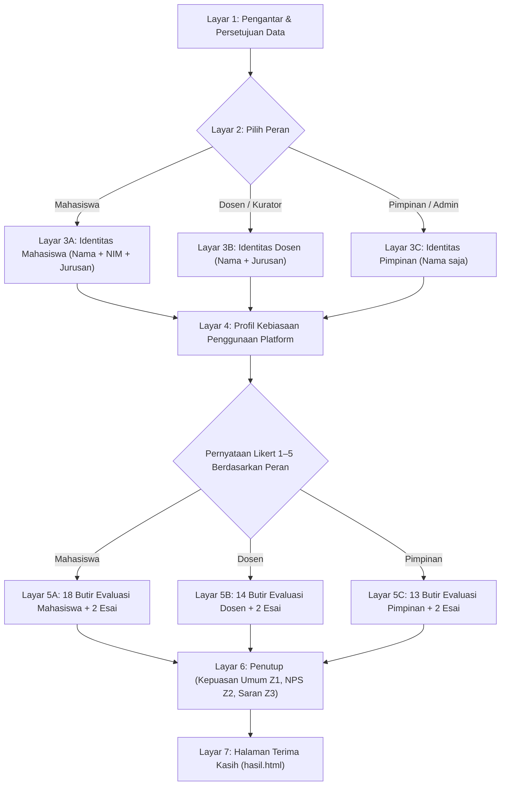

# Rancangan Kuesioner Kepuasan Pengguna Platform Portofolio IDN

Instrumen kuesioner evaluasi kepuasan layanan pengguna untuk platform **Portofolio Mahasiswa Politeknik IDN** (`portofolio-idn`). Dirancang berdasarkan pemetaan menyeluruh terhadap fitur, alur kerja, dan basis data aktual pada kode aplikasi Laravel di `D:\PROJECT FEBRYAN\portofolio-idn`.

---

## 1. Analisis Fitur per Role (Berdasarkan Kode Nyata `portofolio-idn`)

| Role Pengguna | Kode Sistem | Cakupan Fitur Utama yang Digunakan |
|---|---|---|
| **Mahasiswa** | `mahasiswa` | Registrasi Akun Mandiri (`/signup`) dengan validasi Captcha gambar (`/captcha`), Login Sistem (`/signin`), Keamanan Akun & Ubah Password (`/security/change-password`), Manajemen Profil Saya (`/m/profile-saya`: bio, kontak, foto profil, link media sosial GitHub, LinkedIn, Dribbble/Behance), Manajemen Portofolio Saya (`/m/portofolio-saya`: tambah, edit, hapus), Optimasi Gambar Cover Otomatis (konversi WebP terkompresi tanpa mengurangi kualitas visual), Pembuatan Slug URL Otomatis, Galeri Gambar Demonstrasi (Carousel multiple-image), Deskripsi Proyek Berbab/Terstruktur (latar belakang, teknologi/stack, arsitektur sistem, tantangan, hasil karya), Pratinjau Tampilan Karya (`preview`), Pengajuan Kurasi Publikasi (`isPublish`: draft vs published), Pemantauan Metrik Portofolio (Counter Views & Likes pembaca), serta Tampilan Profil Publik di Direktori Mahasiswa. |
| **Dosen / Kurator** | `dosen` | Peninjauan Portofolio Mahasiswa Bimbingan per Jurusan (`Programmer`, `Engineer`, `Designer`) dan per Angkatan, Pemeriksaan Kelengkapan Dokumentasi Proyek (ringkasan, carousel gambar, deskripsi bab teknis, link repositori/demo), Evaluasi Portofolio sebagai Bukti Capaian Pembelajaran Praktikum / Proyek Capstone / Tugas Akhir, Peninjauan Halaman Grafik Statistik Sebaran Karya (`/grafik`), Pemantauan Leaderboard Karya Terpopuler dan Mahasiswa Berprestasi (`/leaderboard`), Kurasi Standar Industri, serta Efisiensi Waktu Evaluasi Karya Mahasiswa secara Terpusat. |
| **Pimpinan / Admin** | `admin` | Dashboard Analitik Eksekutif (`/a/dashboard`: total portofolio terbit vs draft, total mahasiswa aktif, data per jurusan & angkatan), Moderasi & Verifikasi Publikasi Portofolio Mahasiswa (`verify-publish`, `preview`, `delete-porto`), Manajemen Akun Mahasiswa (`/a/mahasiswas`: verifikasi pendaftaran akun baru, unverify, reset password darurat), Manajemen Master Data Jurusan (`/a/jurusans`) & Angkatan (`/a/angkatans`), Pengelolaan Pengumuman Event/Showcase Kampus (`/a/pengumuman`: draft, publish instan, penjadwalan otomatis `schedule`), Pengaturan Platform (`/a/settings`), Otorisasi Hak Akses Sistem, serta Pemanfaatan Platform sebagai Etalase Resmi Kampus untuk Akreditasi dan Promosi ke Mitra Industri. |

---

## 2. Metodologi Pengukuran: Skala Likert 1–5, NPS, dan EUCS

### Keunggulan Skala Likert 1–5 Berlabel Penuh
1. **Standar Psikometri Akademik**: Skala 1–5 memiliki titik tengah netral yang seimbang serta mudah dipahami oleh seluruh jenjang pengguna.
2. **Label yang Konsisten**: Menghindari multitafsir responden:
   - `1` = Sangat Tidak Setuju (STS)
   - `2` = Tidak Setuju (TS)
   - `3` = Netral (N)
   - `4` = Setuju (S)
   - `5` = Sangat Setuju (SS)
3. **Pernyataan Positif Searah**: Seluruh butir dirumuskan dalam kalimat positif tunggal agar skor tinggi selalu mencerminkan kinerja layanan yang prima.
4. **Kombinasi Esai Kualitatif**: Disertai 2 pertanyaan esai singkat per peran guna menangkap akar masalah dan masukan konkrit di balik penilaian angka.

### Net Promoter Score (NPS)
Pertanyaan tunggal penutup berskala 0–10:
> *"Seberapa besar kemungkinan Anda merekomendasikan penggunaan platform Portofolio IDN kepada rekan mahasiswa, dosen, atau mitra industri lainnya?"*
- **Promoter (Skor 9–10)**: Pengguna antusias yang puas dan aktif merekomendasikan platform.
- **Passive (Skor 7–8)**: Pengguna yang merasa sistem cukup baik, namun belum sepenuhnya terkesan.
- **Detractor (Skor 0–6)**: Pengguna yang mengalami kendala teknis atau merasa platform belum memenuhi ekspektasi.

### 5 Dimensi EUCS (*End-User Computing Satisfaction*)
Setiap butir dipetakan ke dalam 5 dimensi evaluasi sistem informasi (Doll & Torkzadeh):
- **C (Content / Isi Informasi)**: Kelengkapan profil, kejelasan dokumentasi proyek berbab, transparansi kurasi karya, dan visibilitas metrik analitik.
- **A (Accuracy / Keakuratan & Keandalan)**: Ketepatan kompresi WebP, keandalan counter likes/views, keamanan login/password, dan keakuratan filter data.
- **F (Format / Tampilan & Tata Letak)**: Kerapian antarmuka showcase landing page, estetika kartu karya, kenyamanan carousel gambar, dan keterbacaan tipografi.
- **E (Ease of Use / Kemudahan Penggunaan)**: Kemudahan registrasi akun, navigasi menu, pengunggahan karya, input galeri, pratinjau, dan verifikasi admin.
- **T (Timeliness / Kecepatan & Ketepatan Waktu)**: Kecepatan memuat halaman, responsivitas upload gambar WebP, dan ketepatan waktu kurasi publikasi karya.

---

## 3. Struktur Alur Formulir

---

## 4. Bagian 1 — Data Responden & Profil Penggunaan

| No | Pertanyaan Profil | Tipe Input | Pilihan Jawaban |
|---|---|---|---|
| 1 | Peran Anda di Platform Portofolio IDN | Pilihan Kartu | Mahasiswa / Dosen (Kurator/Pembimbing) / Pimpinan (Admin) |
| 2 | Nama Lengkap | Isian Teks | Wajib diisi semua peran |
| 3 | Nomor Induk Mahasiswa (NIM) | Isian Teks Angka | Khusus Mahasiswa (Dosen & Pimpinan tanpa NIM) |
| 4 | Program Studi / Jurusan | Pilihan Dropdown | • `58302` - Teknologi Rekayasa Perangkat Lunak (Programmer) • `90346` - Teknologi Rekayasa Komputer Jaringan (Engineer) • `90343` - Teknologi Rekayasa Multimedia Grafis (Designer) |
| 5 | Berapa banyak portofolio yang telah Anda unggah / tinjau? | Pilihan Radio | Belum pernah / 1–2 karya / 3–5 karya / Lebih dari 5 karya |
| 6 | Berapa rata-rata frekuensi mengakses platform Portofolio IDN? | Pilihan Radio | Setiap hari / Beberapa kali seminggu / Sebulan sekali / Saat ada tugas/event pameran saja |
| 7 | Perangkat utama yang Anda gunakan saat mengakses platform | Pilihan Radio | Laptop / PC / HP (Smartphone) / Tablet |

---

## 5. Bagian 2A — Butir Evaluasi Mahasiswa (18 Butir Likert 1–5)

### Grup 1: Akses, Tampilan & Profil Pribadi (M1 – M4)
| Kode | Pernyataan | Fitur Aplikasi | Dimensi EUCS |
|---|---|---|:---:|
| **M1** | Proses pendaftaran akun (dengan captcha) dan login ke platform Portofolio IDN mudah dan lancar | Registrasi & Login | **E** |
| **M2** | Desain tampilan antarmuka platform modern, rapi, dan nyaman dipandang | Desain Antarmuka | **F** |
| **M3** | Menu navigasi dan dashboard mahasiswa mudah dipahami dan digunakan | Navigasi & Dashboard | **E** |
| **M4** | Fitur pengelolaan profil (biodata, foto profil, keahlian, link GitHub/LinkedIn/kontak) mudah dilengkapi | Kelola Profil | **E** |

### Grup 2: Pengunggahan & Manajemen Portofolio (M5 – M9)
| Kode | Pernyataan | Fitur Aplikasi | Dimensi EUCS |
|---|---|---|:---:|
| **M5** | Formulir pembuatan dan pengunggahan portofolio baru (judul, ringkasan, slug) terstruktur dan mudah diisi | Form Portofolio | **E** |
| **M6** | Fitur kompresi gambar cover otomatis ke WebP membuat proses upload cepat tanpa menurunkan kualitas visual | Optimasi WebP | **A** |
| **M7** | Fitur galeri gambar carousel mempermudah penyajian dokumentasi atau tangkapan layar karya secara interaktif | Galeri Carousel | **F** |
| **M8** | Fitur penulisan deskripsi proyek berbab (latar belakang, teknologi, alur, hasil) membantu mendokumentasikan karya secara terperinci | Deskripsi Proyek | **C** |
| **M9** | Fitur pratinjau (*preview*) karya sebelum diajukan publikasi membantu memastikan tampilan karya sudah rapi | Pratinjau Karya | **E** |

### Grup 3: Transparansi Kurasi, Interaksi & Keamanan (M10 – M13)
| Kode | Pernyataan | Fitur Aplikasi | Dimensi EUCS |
|---|---|---|:---:|
| **M10** | Informasi status karya (draf, proses kurasi, dan terverifikasi terbit) disajikan secara jelas dan transparan | Status Kurasi | **C** |
| **M11** | Metrik jumlah pembaca (*views*) dan penyuka (*likes*) tampil akurat serta memotivasi untuk terus berkarya | Metrik Views/Likes | **A** |
| **M12** | Fitur keamanan akun dan penggantian kata sandi berfungsi dengan baik dan memberi rasa aman | Keamanan Akun | **A** |
| **M13** | Halaman publik detail portofolio menyajikan karya secara elegan dan siap dibagikan kepada calon perekrut industri | Tampilan Publik | **F** |

### Grup 4: Performa, Manfaat & Kesiapan Karir (M14 – M18)
| Kode | Pernyataan | Fitur Aplikasi | Dimensi EUCS |
|---|---|---|:---:|
| **M14** | Fitur Leaderboard dan direktori karya mahasiswa memicu motivasi kompetisi positif untuk menghasilkan karya bermutu | Leaderboard & Direktori | **C** |
| **M15** | Halaman platform terbuka dengan cepat dan responsif saat diakses dari komputer maupun smartphone | Kecepatan Akses | **T** |
| **M16** | Platform stabil dan tidak mengalami gangguan teknis saat proses pengunggahan berkas karya berlangsung | Stabilitas Sistem | **A** |
| **M17** | Waktu yang dibutuhkan admin/kurator dalam memverifikasi dan menerbitkan karya tergolong cepat | Waktu Kurasi | **T** |
| **M18** | Platform Portofolio IDN sangat membantu dalam membangun personal branding dan meningkatkan kepercayaan diri memasuki dunia kerja | Dampak Karir | **C** |

#### Pertanyaan Terbuka Mahasiswa:
- **M_OPEN_1**: Fitur apa pada platform Portofolio IDN yang paling Anda sukai atau paling membantu dalam memamerkan karya Anda? *(Contoh: galeri carousel, optimasi webp, deskripsi terstruktur, link sosmed, dll.)*
- **M_OPEN_2**: Kendala teknis apa yang pernah Anda alami saat mengunggah atau mengelola portofolio di platform ini? *(Contoh: proses upload foto, preview kurang pas, waktu verifikasi, tampilan mobile, dll.)*

---

## 6. Bagian 2B — Butir Evaluasi Dosen / Kurator (14 Butir Likert 1–5)

### Grup 1: Antarmuka & Peninjauan Karya (D1 – D4)
| Kode | Pernyataan | Fitur Aplikasi | Dimensi EUCS |
|---|---|---|:---:|
| **D1** | Tampilan antarmuka platform Portofolio IDN mudah dipahami, intuitif, dan nyaman digunakan | Antarmuka Platform | **F** |
| **D2** | Informasi karya mahasiswa per jurusan (`Programmer`, `Engineer`, `Designer`) dan angkatan disajikan lengkap | Struktur Informasi | **C** |
| **D3** | Format dokumentasi karya (ringkasan, tangkapan layar carousel, dan deskripsi teknis) memudahkan peninjauan karya | Format Dokumentasi | **F** |
| **D4** | Platform mempermudah dosen dalam memantau portofolio karya mahasiswa bimbingan secara terpusat | Monitoring Karya | **E** |

### Grup 2: Kurasi, Direktori & Statistik (D5 – D9)
| Kode | Pernyataan | Fitur Aplikasi | Dimensi EUCS |
|---|---|---|:---:|
| **D5** | Fitur pencarian dan filter jurusan memudahkan penemuan karya spesifik yang sedang dievaluasi | Pencarian & Filter | **E** |
| **D6** | Halaman direktori profil mahasiswa menyajikan rekam jejak keterampilan dan karya mahasiswa secara terperinci | Direktori Mahasiswa | **C** |
| **D7** | Halaman grafik statistik sebaran karya (`/grafik`) memberikan gambaran jelas mengenai produktivitas mahasiswa | Grafik Analitik | **C** |
| **D8** | Fitur Leaderboard menyajikan data karya terpopuler dan mahasiswa paling aktif secara transparan dan akurat | Akurasi Leaderboard | **A** |
| **D9** | Platform efektif digunakan sebagai etalase penilaian luaran praktikum, proyek semester, maupun tugas akhir | Evaluasi Capaian | **C** |

### Grup 3: Efisiensi, Keandalan & Standar Mutu (D10 – D14)
| Kode | Pernyataan | Fitur Aplikasi | Dimensi EUCS |
|---|---|---|:---:|
| **D10** | Platform menghemat waktu dan beban administratif dosen dibanding peninjauan karya melalui berkas manual | Efisiensi Kerja | **T** |
| **D11** | Gambar, media carousel, dan halaman karya mahasiswa termuat dengan cepat tanpa kendala teknis | Kecepatan Media | **T** |
| **D12** | Data identitas, jurusan, dan kepemilikan karya mahasiswa yang disajikan akurat dan valid | Keabsahan Data | **A** |
| **D13** | Platform berjalan stabil dan jarang mengalami gangguan teknis saat digunakan untuk kurasi karya | Keandalan Sistem | **A** |
| **D14** | Keberadaan platform Portofolio IDN mendorong peningkatan mutu dan kesiapan kerja karya mahasiswa sesuai standar industri | Peningkatan Mutu | **C** |

#### Pertanyaan Terbuka Dosen / Kurator:
- **D_OPEN_1**: Aspek apa yang menurut Anda masih memerlukan penyempurnaan dalam proses peninjauan atau kurasi karya mahasiswa? *(Misalnya format laporan proyek, fitur komentar/feedback dosen, penilaian langsung, dll.)*
- **D_OPEN_2**: Fitur tambahan apa yang paling Anda harapkan untuk mendukung pembimbingan portofolio mahasiswa ke depan? *(Misalnya badge sertifikasi, filter berbasis teknologi/tools, ekspor ringkasan portofolio mahasiswa, dll.)*

---

## 7. Bagian 2C — Butir Evaluasi Pimpinan / Admin (13 Butir Likert 1–5)

### Grup 1: Dashboard Eksekutif & Manajemen Data (P1 – P4)
| Kode | Pernyataan | Fitur Aplikasi | Dimensi EUCS |
|---|---|---|:---:|
| **P1** | Dashboard admin menyajikan gambaran ringkas dan informatif mengenai statistik portofolio dan mahasiswa kampus | Dashboard Admin | **C** |
| **P2** | Pengelolaan master data Jurusan dan Angkatan terstruktur rapi dan mudah diperbarui | Master Data | **E** |
| **P3** | Fitur verifikasi akun pendaftaran mahasiswa baru (`verify`/`unverify`) berjalan efektif dan mempermudah tata kelola | Tata Kelola Akun | **E** |
| **P4** | Fitur moderasi dan verifikasi publikasi portofolio (`verify-publish`) efektif menjaga standar mutu karya yang tampil ke publik | Moderasi Kurasi | **A** |

### Grup 2: Komunikasi, Pengaturan & Reputasi Publik (P5 – P8)
| Kode | Pernyataan | Fitur Aplikasi | Dimensi EUCS |
|---|---|---|:---:|
| **P5** | Fitur pratinjau (*preview*) karya pada panel admin mempermudah peninjauan sebelum memberikan persetujuan tayang | Pratinjau Admin | **E** |
| **P6** | Fitur manajemen pengumuman kampus (draft, rilis terjadwal otomatis `schedule`) berjalan tepat waktu dan andal | Pengumuman Terjadwal | **T** |
| **P7** | Pengaturan status platform (`settings`) dan hak akses peran aman sesuai kewenangan operasional | Keamanan Otorisasi | **A** |
| **P8** | Tampilan etalase publik portofolio mencerminkan reputasi profesional Politeknik IDN di mata masyarakat dan industri | Citra Kelembagaan | **F** |

### Grup 3: Kecepatan, Akreditasi & Dampak Industri (P9 – P13)
| Kode | Pernyataan | Fitur Aplikasi | Dimensi EUCS |
|---|---|---|:---:|
| **P9** | Visualisasi grafik statistik membantu pimpinan dalam monitoring capaian indikator kinerja institusi | Analitik Pimpinan | **C** |
| **P10** | Kecepatan akses dan responsivitas platform memberikan pengalaman positif bagi mitra industri dan recruiter | Impresi Industri | **T** |
| **P11** | Platform Portofolio IDN sangat mendukung pemenuhan dokumentasi luaran karya untuk akreditasi program studi | Dukungan Akreditasi | **C** |
| **P12** | Platform memiliki keandalan sistem dan keamanan data yang baik untuk keberlanjutan operasional jangka panjang | Keberlanjutan Sistem | **A** |
| **P13** | Implementasi Portofolio IDN berhasil memperkuat sinergi *link and match* antara lulusan kampus dengan kebutuhan industri | Kesiapan Kerja Lulusan | **C** |

#### Pertanyaan Terbuka Pimpinan / Admin:
- **P_OPEN_1**: Informasi atau metrik analitik tambahan apa yang paling Anda butuhkan pada dashboard eksekutif untuk pengambilan keputusan kampus? *(Misalnya statistik minat industri per karya, tren teknologi terpopuler, rekap serapan magang, dll.)*
- **P_OPEN_2**: Apa saran prioritas Anda untuk pengembangan jangka panjang dan integrasi platform Portofolio IDN ke depan? *(Misalnya integrasi akun industri terverifikasi, pameran virtual 3D, integrasi tracer study, dll.)*

---

## 8. Bagian 3 — Pertanyaan Penutup (Wajib Diisi Seluruh Peran)

| Kode | Pertanyaan | Tipe Input | Skala / Opsi |
|---|---|---|---|
| **Z1** | Secara keseluruhan, seberapa puas Anda dengan kualitas layanan platform Portofolio IDN? | Skala Likert 1–5 | 1 = Sangat tidak puas 2 = Tidak puas 3 = Cukup 4 = Puas 5 = Sangat puas |
| **Z2** | Seberapa besar kemungkinan Anda merekomendasikan penggunaan platform Portofolio IDN kepada rekan mahasiswa, dosen, atau mitra industri lainnya? | Skala NPS 0–10 | 0 = Sangat tidak mungkin merekomendasikan 10 = Sangat mungkin merekomendasikan |
| **Z3** | Kritik, saran, atau masukan bebas untuk peningkatan kualitas layanan platform Portofolio IDN | Isian Teks Bebas | Opsional (Saran peningkatan fitur, tampilan, atau layanan) |

---

## 9. Rekapitulasi Distribusi Dimensi EUCS

| Dimensi EUCS | Mahasiswa (M) | Dosen / Kurator (D) | Pimpinan / Admin (P) | Total Butir | Persentase |
|---|:---:|:---:|:---:|:---:|:---:|
| **C - Content** (Isi Informasi) | 4 | 5 | 4 | **13** | 28,9% |
| **A - Accuracy** (Keakuratan & Keandalan) | 4 | 3 | 3 | **10** | 22,2% |
| **F - Format** (Tampilan & Tata Letak) | 3 | 2 | 1 | **6** | 13,3% |
| **E - Ease of Use** (Kemudahan Penggunaan) | 5 | 2 | 3 | **10** | 22,2% |
| **T - Timeliness** (Kecepatan & Waktu) | 2 | 2 | 2 | **6** | 13,3% |
| **Total Butir Likert** | **18** | **14** | **13** | **45** | **100%** |
