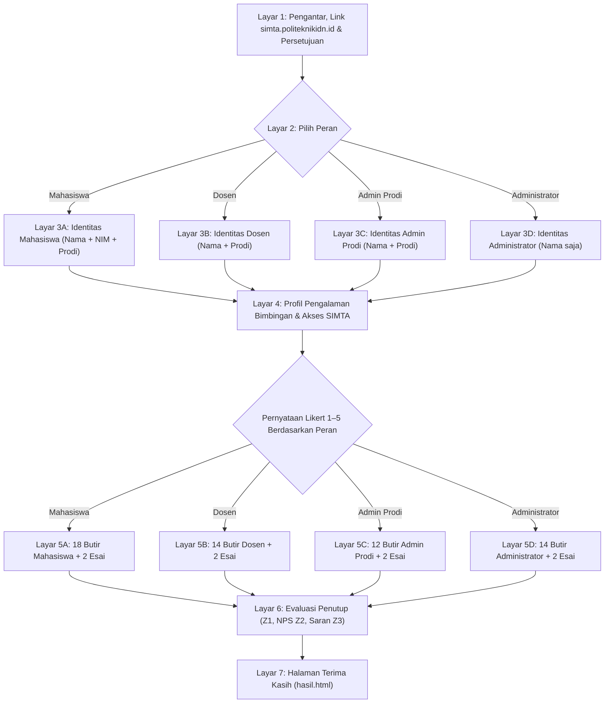

# Rencana Arsitektur & Pengembangan Kuesioner Kepuasan SIMTA

Dokumen spesifikasi teknis dan rencana implementasi instrumen evaluasi kepuasan layanan pengguna untuk platform **SIMTA (Sistem Informasi Manajemen Tugas Akhir)** Politeknik IDN Bogor.

Aplikasi resmi yang dievaluasi dapat diakses secara publik melalui tautan:
🌐 **[https://simta.politeknikidn.id](https://simta.politeknikidn.id)**

---

## 1. Analisis Sistem & Alur Kerja SIMTA (`SIMTA-With-Faisal`)

Berdasarkan analisis menyeluruh terhadap arsitektur kode sumber di `D:\PROJECT FEBRYAN\SIMTA-With-Faisal` (Laravel 13, Inertia.js v3, React 19, Tailwind CSS v4, Ziggy, dan PostgreSQL/MySQL):

### Struktur Peran Pengguna Resmi (Sesuai `LayoutApp.jsx` & `routes/`):
1. **`mahasiswa` (Mahasiswa)**:
   - Login mandiri menggunakan NIM atau Email kampus.
   - Mengisi & melengkapi profil biodata mahasiswa (`profil.lengkap` middleware).
   - Memantau pengumuman resmi dan menandai telah dibaca (*mark as read*).
   - Menyampaikan pengaduan & aspirasi terkait kendala bimbingan / sidang.
   - Mengajukan usulan judul/topik tugas akhir dan mengajukan permohonan dosen pembimbing pilihan.
   - Mengakses **Pusat Unduhan** berkas template dokumen resmi & pedoman TA kampus.
   - Mengecek direktori **Data Dosen** (keahlian dosen & kuota bimbingan tersisa).
   - Mengeksplorasi **Referensi Judul** tugas akhir angkatan terdahulu.
   - Mengunggah berkas syarat pendaftaran **Seminar Proposal** (`syarat-proposal`).
   - Memantau jadwal, ruangan, dan penguji ujian proposal.
   - Mencetak dokumen resmi ber-QR Code validasi keaslian: **SK Pembimbing**, **SK Proposal**, dan **SK Sidang TA**.
   - Mengunggah berkas syarat pendaftaran **Sidang Tugas Akhir** (`syarat-sidang-ta`).
   - Memantau rekapitulasi **Riwayat Ujian** dan perolehan nilai kelulusan.

2. **`dosen` (Dosen — Pembimbing & Penguji)**:
   - Login menggunakan Nomor Identitas (NIDN/NUPTK) atau Email.
   - Dashboard dosen: ringkasan kuota bimbingan, jadwal ujian seminar proposal & sidang TA mendatang.
   - Mengelola **Permintaan Bimbingan**: menyetujui (*acc*), memberi catatan revisi, atau menolak usulan judul mahasiswa bimbingan.
   - Memperbarui tautan grup koordinasi bimbingan (*link group* WhatsApp / Telegram).
   - Melihat dan mencetak berkas resmi **SK Dosen Pembimbing** ber-QR Code.
   - Menelusuri **Judul Mahasiswa** (referensi topik skripsi/tugas akhir di lingkungan kampus).
   - Mengisi **Penilaian Ujian Seminar Proposal** secara terstruktur sesuai rincian komponen bobot nilai (latar belakang, rumusan masalah, metodologi, dan penguasaan materi).
   - Mengisi **Penilaian Ujian Sidang Tugas Akhir** secara terstruktur sesuai komponen bobot penilaian akhir (produk/aplikasi, laporan TA, presentasi, dan tanya jawab).

3. **`admin_prodi` (Admin Prodi — Pengelola Program Studi)**:
   - Mengakses dashboard terisolasi berdasarkan slug program studi (`{prodi}/dashboard`: `TRPL`, `TRKJ`, `TRMG`).
   - Memverifikasi dan memoderasi usulan judul tugas akhir mahasiswa prodi (*acc* pembimbing, tolak pembimbing, batal *acc*, atau ganti pembimbing).
   - Melakukan **Validasi Berkas Syarat Proposal** mahasiswa program studinya.
   - Melakukan **Validasi Berkas Syarat Sidang TA** mahasiswa program studinya.
   - Memantau dan melakukan penyesuaian cepat (*quick-kuota*) alokasi bimbingan dosen di prodinya.
   - Mengekspor data rekapitulasi judul dan progres penyelesaian TA prodi ke Excel.

4. **`admin` (Administrator — Koordinator TA Pusat)**:
   - Dashboard analitik institusi: statistik total judul diajukan, seminar proposal terjadwal, sidang TA selesai, dan distribusi bimbingan dosen se-kampus.
   - Manajemen **Pengumuman Terpusat** (broadcast ke seluruh civitas academica).
   - Manajemen & tindak lanjut **Pengaduan & Aspirasi** civitas academica.
   - Manajemen Master Data: Tahun Angkatan, Program Studi, Topik/Bidang Penelitian, Ruangan Sidang, dan Pejabat Penandatangan SK.
   - Manajemen User: Data Mahasiswa (import Excel, toggle kelengkapan profil, reset password massal), Data Dosen (import Excel, batas kuota, toggle foto/telepon), Data Admin Prodi.
   - Manajemen Tugas Akhir: Periode Pengajuan Judul, Usulan Judul Kampus, Penerbitan SK Pembimbing resmi, dan SK Dibatalkan.
   - Manajemen Seminar Proposal: Periode Ujian, Komponen Nilai Berbobot, **Fitur Cerdas Auto-Ploting Dosen Penguji & Ruangan**, Cetak Jadwal & Presensi Resmi, Penerbitan SK Ujian Proposal, Rekapitulasi Nilai & Cetak Berita Acara Proposal.
   - Manajemen Sidang TA: Periode Sidang TA, Komponen Nilai Sidang, **Fitur Cerdas Auto-Ploting Jadwal & Ruangan**, Cetak Jadwal & Presensi Resmi, Penerbitan SK Sidang TA, Rekap Nilai Akhir & Cetak Berita Acara Kelulusan.

### 3 Program Studi Resmi Politeknik IDN (Berdasarkan `ProdiSeeder.php`):
- `58302`: **Teknologi Rekayasa Perangkat Lunak** (`TRPL`)
- `90346`: **Teknologi Rekayasa Komputer Jaringan** (`TRKJ`)
- `90343`: **Teknologi Rekayasa Multimedia Grafis** (`TRMG`)

---

## 2. Metodologi Pengukuran: Skala Likert 1–5, NPS, dan EUCS

Survei ini menerapkan instrumen evaluasi sistem informasi akademik berbasis:

1. **Skala Likert 1–5 Berlabel Penuh**:
   - `1` = Sangat Tidak Setuju (STS)
   - `2` = Tidak Setuju (TS)
   - `3` = Netral (N) — *pilihan netral atau belum pernah memakai fiturnya*
   - `4` = Setuju (S)
   - `5` = Sangat Setuju (SS)

2. **Net Promoter Score (NPS 0–10)**:
   Mengukur probabilitas responden merekomendasikan penggunaan platform SIMTA kepada rekan civitas akademika atau kampus lain (Promoter: 9–10, Passive: 7–8, Detractor: 0–6).

3. **5 Dimensi EUCS (*End-User Computing Satisfaction*)**:
   - **C (Content / Isi Informasi)**: Kelengkapan informasi judul, kejelasan status bimbingan/revisi, transparansi komponen nilai proposal & sidang, serta rincian SK resmi.
   - **A (Accuracy / Keakuratan & Keandalan)**: Ketepatan perhitungan nilai bobot ujian, validitas QR code verifikasi SK publik (`/validasi-sk/{uuid}`), keabsahan kuota dosen, dan stabilitas server.
   - **F (Format / Tampilan & Tata Letak)**: Kerapian antarmuka, kenyamanan tata letak menu, format cetak resmi dokumen PDF (SK, jadwal, presensi, berita acara) berstandar institusi.
   - **E (Ease of Use / Kemudahan Penggunaan)**: Kemudahan login NIM/NIDN, pengajuan judul, pengunggahan berkas syarat, input nilai oleh dosen, dan auto-ploting jadwal.
   - **T (Timeliness / Kecepatan & Ketepatan Waktu)**: Kecepatan memuat halaman web, responsivitas penyimpanan berkas, ketepatan notifikasi pengumuman, dan efisiensi waktu penjadwalan sidang.

---

## 3. Alur Formulir Interaktif (Wizard)

---

## 4. Rincian Kolom Sheet Google Spreadsheet `Respon` (Total 82 Kolom)

Sheet `Respon` dirancang untuk menampung seluruh data secara rapi dan terisolasi:

1. **Kolom 1–13 (Metadata & Profil Responden)**:
   - `timestamp` (Waktu pengisian)
   - `id_respon` (ID acak unik responden untuk idempotensi)
   - `versi_form` (`v1`)
   - `peran` (`mahasiswa`, `dosen`, `admin_prodi`, `admin`)
   - `nama` (Nama lengkap responden)
   - `nim` (NIM mahasiswa; kosong untuk peran lain)
   - `prodi` (Nama Program Studi; kosong untuk Administrator)
   - `kode_prodi` (Kode Prodi: `58302`, `90346`, `90343`; kosong untuk Administrator)
   - `pengalaman_ta` (Tahapan TA yang sedang/telah dijalani)
   - `frekuensi_akses` (Frekuensi membuka SIMTA)
   - `perangkat` (Laptop/PC, Smartphone, Tablet)
   - `durasi_detik` (Durasi pengerjaan survei)
   - `user_agent` (Browser & OS responden)
2. **Kolom 14–31 (18 Butir Mahasiswa)**: `M1` s.d. `M18`
3. **Kolom 32–45 (14 Butir Dosen)**: `D1` s.d. `D14`
4. **Kolom 46–57 (12 Butir Admin Prodi)**: `AP1` s.d. `AP12`
5. **Kolom 58–71 (14 Butir Administrator)**: `P1` s.d. `P14`
6. **Kolom 72–73 (Penutup Numerik)**:
   - `Z1` (Kepuasan Umum Skala 1–5)
   - `Z2` (NPS Rekomendasi Skala 0–10)
7. **Kolom 74–82 (Pertanyaan Kualitatif Terbuka & Saran)**:
   - `M_OPEN_1` & `M_OPEN_2` (Esai Mahasiswa)
   - `D_OPEN_1` & `D_OPEN_2` (Esai Dosen)
   - `AP_OPEN_1` & `AP_OPEN_2` (Esai Admin Prodi)
   - `P_OPEN_1` & `P_OPEN_2` (Esai Administrator)
   - `Z3` (Kritik, saran & masukan umum bebas)

**Total: 13 + 58 + 2 + 9 = 82 Kolom.**

---

## 5. Jaminan Keamanan, Privasi & Zero-PII Leak

- **Zero-PII Leak**: Nama dan NIM responden disimpan di sheet `Respon` dan **tidak pernah dikirimkan ke endpoint dashboard** (`doGet(?mode=rekap)`). Dashboard hanya menerima ringkasan nilai agregat rata-rata, persentase, dan jawaban esai anonim.
- **Proteksi PIN Dinamis**: Akses dashboard hasil survei dapat dikunci dengan PIN dari sheet `Pengaturan` cell `B2`.
- **Anti Formula Injection**: Seluruh input teks yang diawali karakter manipulasi spreadsheet (`=`, `+`, `-`, `@`, `'`) otomatis dinetralkan.
- **Penyimpanan Draf & Antrean Offline**: Jawaban tersimpan otomatis di `localStorage` peramban. Jika koneksi terputus, data diantrekan secara lokal dan otomatis disinkronisasi ketika online.

